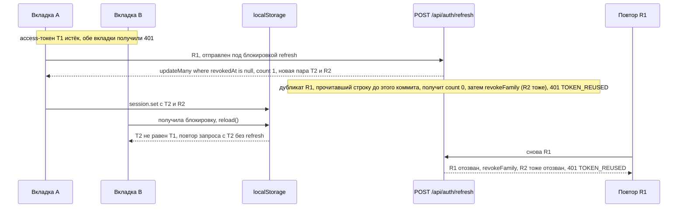

# FlowDesk

English version: [README.md](README.md)


Мини-CRM для отдела продаж: канбан сделок, контакты, карточка сделки с заметками и историей, дашборд, роли admin и manager. Фронтенд на Next.js со статическим экспортом ходит в API на Fastify и Prisma, а между ними общий пакет с zod-контрактом, политикой прав и функциями аналитики.

Это демо-проект на сгенерированных данных, а не продукт для клиента. Название FlowDesk выдумано, все компании, контакты и сделки выдаёт детерминированный генератор в [`packages/shared/src/demo-data.ts`](packages/shared/src/demo-data.ts): e-mail на зарезервированных доменах `.example`, телефоны из зарезервированного диапазона 555-01XX.

Демо: https://sinnercode228.github.io/flowdesk-crm/ — тот же REST-API работает прямо в браузере, состояние лежит в localStorage, бэкенда за ним нет. Форма входа уже заполнена учёткой admin, кнопка Manager подставляет вторую (`admin@flowdesk.example` и `manager@flowdesk.example`, пароль у обоих `demo1234`). Кнопка Reset data в шапке возвращает исходные данные.

## Гонка за refresh-токеном



Вкладки делят сессию в localStorage и делают refresh под одной блокировкой `navigator.locks`, если браузер её даёт, поэтому вторая вкладка находит пару, которую получила первая, и повторяет запрос с ней, а не отправляет R1 ещё раз ([`client.ts:68-95`](web/src/lib/api/client.ts#L68-L95), [`session-store.ts:26-38`](web/src/lib/api/session-store.ts#L26-L38)). Разбор того, как связаны ротация, проверка повтора и блокировка между вкладками: [Ротация refresh-токенов в FlowDesk через условный UPDATE и блокировку между вкладками](https://github.com/sinnercode228/sinnercode228/blob/main/notes/flowdesk-refresh-rotation.ru.md).

Access-токен — JWT на 15 минут: HS256 через `jose`, при проверке алгоритм зафиксирован, issuer и audience сверяются. Refresh-токен — не JWT, а 32 случайных байта в base64url; он одноразовый и живёт 7 дней (сроки задаются `JWT_ACCESS_TTL` и `REFRESH_TOKEN_TTL_DAYS`). В базе лежит только его SHA-256 ([`server/src/lib/tokens.ts`](server/src/lib/tokens.ts)), так что дамп таблицы `RefreshToken` готовых токенов не даёт. Медленный хэш для 256 случайных бит не нужен.

`POST /api/auth/refresh` отзывает предъявленный токен и выдаёт новую пару с тем же `familyId`, общим для всех токенов одного логина; `replacedById` связывает каждую строку с её преемником. Если на refresh приходит уже отозванный токен, его отправил второй раз либо сам клиент, либо тот, кто его скопировал. Кто из них настоящий, сервер не знает, поэтому отзывает всю семью и отвечает `401 TOKEN_REUSED`, и войти заново придётся обоим ([`auth.service.ts:42-43`](server/src/modules/auth/auth.service.ts#L42-L43), [`:112-116`](server/src/modules/auth/auth.service.ts#L112-L116)). Другие сессии пользователя это не задевает, у них свои семьи. Цепочку «ротация → повтор старого токена → новый тоже отклонён» проверяют и тесты API, и тесты демо.

Из-за этого правила обычная гонка на клиенте превращается в выход из системы. Дашборд отправляет четыре запроса параллельно (`useAnalytics`, [`web/src/hooks/queries.ts:58`](web/src/hooks/queries.ts#L58)). Если access истёк, все четыре получают 401. Пойди каждый из них за новой парой сам, первый refresh прошёл бы, остальные три принесли бы только что отозванный токен, сервер счёл бы это кражей, отозвал семью, и пользователь оказался бы на странице входа. В `ApiClient` это закрыто одним общим промисом: `refresh()` кладёт запрос в `this.refreshing` через `??=`, параллельные 401 ждут его и повторяют себя с новым access-токеном ([`web/src/lib/api/client.ts:91-94`](web/src/lib/api/client.ts#L91-L94)). В [`client.test.ts:42-53`](web/src/lib/api/client.test.ts#L42-L53) два запроса уходят с истёкшим access-токеном, и до `/auth/refresh` доходит ровно один вызов.

Сервер на это не полагается. Два запроса с одним живым токеном оба прочитают его с `revokedAt = null`, и без защиты каждый выпустил бы по новой паре: у семьи появились бы две рабочие ветки. От этого защищает условное обновление внутри транзакции ([`auth.service.ts:46-67`](server/src/modules/auth/auth.service.ts#L46-L67)):

```ts
const session = await this.prisma.$transaction(async (tx) => {
  // Conditional update: of two concurrent refreshes with the same token, only one wins.
  const { count } = await tx.refreshToken.updateMany({
    where: { id: stored.id, revokedAt: null },
    data: { revokedAt: now },
  });
  if (count !== 1) return null;
  // ... выпуск новой пары, связь через replacedById
});
if (!session) return this.reuseDetected(stored.familyId, now);
```

Строку обновит только один запрос. Второй увидит `count === 0`, и этот случай я обрабатываю так же, как найденный уже отозванным токен: семья отзывается вне транзакции, чтобы откат её не отменил, ответ — `401 TOKEN_REUSED`. Проигранное обновление значит только, что токен отозвали между чтением и записью, и сервер всё так же не может отличить двойную отправку клиента от вора, который соревнуется с клиентом. Если бы выиграл запрос вора, а семья осталась жива, у вора остался бы рабочий токен, а настоящего пользователя выкинуло бы. Обновление возвращает 0 строк только после коммита транзакции победителя, поэтому refresh-токен, который победитель только что получил, отзывается вместе с остальными, и оба входят заново, когда истечёт их access-токен. Опоздавший дубликат получает один и тот же исход, пришёл он до коммита победителя или после. Две вкладки одной сессии клиент разводит сам, как на схеме выше. [`auth.test.ts:159-220`](server/test/auth.test.ts#L159-L220) отправляет два refresh с одним токеном одновременно через HTTP, а ещё придерживает оба чтения, пока строку не прочитают оба, чтобы проигравший мог проиграть только на условном обновлении; в обоих случаях один получает 200, другой `TOKEN_REUSED`, и живых токенов в семье не остаётся.

Refresh-токены не копятся вечно. Когда пользователь входит, сервер удаляет его семьи токенов, в которых истекли все токены ([`auth.service.ts:118-139`](server/src/modules/auth/auth.service.ts#L118-L139)). За один логин удаляется не больше 500 таких семей, и находит их сама база через `groupBy` по самому позднему `expiresAt`, поэтому размер запросов не зависит от числа сессий пользователя. Это важно для PostgreSQL, который не принимает запрос с больше чем 32 767 параметрами: запрос со списком всех живых семей перестал бы пускать общий демо-аккаунт, на который за неделю вошли столько раз. Ни один токен такой семьи уже нельзя обменять, так что ловить повтор там нечего. Семья, в которой есть действующий токен, хранит все свои строки, включая отозванные, поэтому повтор любого её старого токена по-прежнему отзывает семью. Я выбрал логин, а не фоновый таймер: не нужен планировщик, и с несколькими экземплярами API всё работает так же. Цена — у пользователя, который больше не входит, остаются его последние истёкшие семьи, но эти строки уже не растут.

`POST /api/auth/logout-all` — это «выйти везде». Его вызывают с access-токеном пользователя, и один `updateMany` ставит `revokedAt` всем живым refresh-токенам этого пользователя, так что все его семьи заканчиваются разом, включая семью вызвавшего ([`auth.service.ts:79-97`](server/src/modules/auth/auth.service.ts#L79-L97)). Токен любой из этих семей, пришедший позже, — такой же повтор, как любой другой: 401 `TOKEN_REUSED`. Логин после вызова начинает новую семью, и эти повторы её не трогают. На PostgreSQL одного обновления мало. Refresh, который уже отозвал свой токен, но ещё не закоммитился, заставляет обновление ждать эту строку, а токен, который он вставит следом, в снимок обновления не попадает: он остаётся живым, и эта сессия переживает вызов. Поэтому та же транзакция увеличивает `User.tokenVersion`: каждая семья хранит версию, с которой началась ([`schema.prisma:43-44`](server/prisma/schema.prisma#L43-L44)), а refresh считает семью со старой версией отозванной ([`auth.service.ts:42-43`](server/src/modules/auth/auth.service.ts#L42-L43)). SQLite даёт писать только одной транзакции за раз, поэтому [`auth.test.ts:359-387`](server/test/auth.test.ts#L359-L387) собирает состояние, которое оставляет такая гонка, и проверяет, что оставшийся токен отклоняется. Access-токены по базе не проверяются: выданный до вызова работает, пока не истечёт, то есть не дольше `JWT_ACCESS_TTL` (по умолчанию 15 минут), так же как после обычного logout или отзыва семьи за повтор. Версия в claim с проверкой на каждом запросе закрыла бы это окно, но добавила бы чтение из базы к каждому вызову API, а `authenticate` сейчас в базу не ходит. В веб-приложении кнопка «Sign out everywhere» стоит под именем пользователя в сайдбаре и просит подтверждения; локальная сессия очищается только после ответа сервера, так что неудавшийся вызов можно повторить.

Refresh, логин и logout-all ограничены отдельно от остальных маршрутов: по умолчанию с одного IP сервер пропускает в минуту 30 запросов на refresh, 10 на логин, 10 на logout-all и 300 на всё остальное; лимиты задаются через `RATE_LIMIT_LOGIN_MAX` (логин и logout-all берут его как есть, refresh — утроенным) и `RATE_LIMIT_MAX` ([`auth.routes.ts`](server/src/modules/auth/auth.routes.ts)). IP — это адрес сокета, если не задан `TRUST_PROXY` ([`app.ts:62-64`](server/src/app.ts#L62-L64)): без прокси перед API в `X-Forwarded-For` лежит то, что написал клиент, и клиент, меняющий его в каждом запросе, до лимита на логин не дошёл бы. За обратным прокси укажите в `TRUST_PROXY` адрес или CIDR прокси (`127.0.0.1`, `10.0.0.0/8` или список через запятую) либо `true`, чтобы доверять любому отправителю; `true` и `false` читаются в любом регистре. Число хопов вроде `1` не проходит проверку при старте: Fastify прочитал бы его как адрес `0.0.0.1`, никому бы не доверял, и все клиенты за прокси делили бы один лимит на логин. Элемент, который не является адресом, CIDR или одним из имён `loopback`, `linklocal` и `uniquelocal`, тоже не даст серверу запуститься; тогда API берёт адрес клиента из `X-Forwarded-For`. В собственном `docker-compose.yml` репозитория прокси перед API нет, поэтому там стоит `TRUST_PROXY: 'false'`. Пароль на логине сверяется через scrypt с N=16384, r=8, p=1. Параметры лежат в самом хэше, поэтому их можно поднять, и старые пароли продолжат проверяться. Если e-mail не найден, пароль всё равно сверяется с фиктивным хэшем, чтобы логин не отвечал на такой адрес заметно быстрее; ошибка в обоих случаях `INVALID_CREDENTIALS` ([`password.ts`](server/src/lib/password.ts), [`auth.service.ts:20-27`](server/src/modules/auth/auth.service.ts#L20-L27)).

## Куда встаёт карточка после перетаскивания


У сделки есть `stageId` и целочисленная `position` внутри колонки. Самый короткий путь — при перетаскивании записать `position = индекс` — быстро даёт дубли и дыры: карточки с одинаковой позицией сортируются как попало, после удаления остаются пропуски, а при переносе между колонками исходная колонка вообще не трогается. Поэтому позиции хранятся без дробных значений и пропусков: после каждого перемещения обе затронутые колонки перенумеровываются в 0..n−1.

`POST /api/deals/:id/move` делает это в одной интерактивной транзакции Prisma ([`deals.service.ts:156-208`](server/src/modules/deals/deals.service.ts#L156-L208)). Он читает целевую колонку без перемещаемой сделки, отсортированную по `position`, а затем по `createdAt` по убыванию, вставляет сделку на нужный индекс (позиция за концом обрезается до длины колонки) и перенумеровывает; если стадия сменилась, так же перенумеровывается исходная колонка. `reindex` пишет только строки, у которых позиция поменялась ([`:34-40`](server/src/modules/deals/deals.service.ts#L34-L40)), так что обмен двух соседних карточек стоит двух `UPDATE`, а перемещение в начало колонки переписывает позицию каждой карточки в ней. При смене стадии в той же транзакции обновляются `stageChangedAt` и `closedAt` (ставится для Won и Lost, сбрасывается при возврате в открытую стадию), а в ленту активности пишется запись. Инвариант держат и создание (новая сделка встаёт наверх, остальные сдвигаются одним `updateMany` с `increment`, [`:89-112`](server/src/modules/deals/deals.service.ts#L89-L112)), и удаление (`decrement` у карточек ниже, [`:210-221`](server/src/modules/deals/deals.service.ts#L210-L221)).

Тот же алгоритм на клиенте — `applyMove` в [`web/src/lib/kanban.ts:17-43`](web/src/lib/kanban.ts#L17-L43), с тем же порядком сортировки. Оптимистичное обновление в `useMoveDeal` применяет его к кэшу TanStack Query до ответа сервера, а при ошибке возвращает в кэш прежний список ([`web/src/hooks/queries.ts:78-95`](web/src/hooks/queries.ts#L78-L95)); нетронутые строки сохраняют идентичность объектов, и React не перерисовывает всю доску. Обработчик `/deals/:id/move` в демо-сервере вызывает ту же функцию ([`web/src/lib/demo/server.ts:434`](web/src/lib/demo/server.ts#L434)), поэтому сборка на GitHub Pages расставляет карточки так же, как настоящий API. Интеграционные тесты проверяют непрерывность позиций после каждого перемещения, создания и удаления (`expectContiguous` в [`server/test/deals.test.ts`](server/test/deals.test.ts)).

Пока включён поиск или фильтр по владельцу, перетаскивание выключено, над доской появляется подсказка «Clear filters to reorder cards.» ([`deals-view.tsx:93-106`](web/src/components/deals/deals-view.tsx#L93-L106)). Индекс, куда бросили карточку, считается по видимой колонке, а фильтр часть колонки прячет, и сервер получил бы не ту позицию. Чужие сделки менеджер тоже не перетащит: карточку блокирует тот же `can()`, что проверяет сервер. Таскать можно мышью, пальцем (после удержания 180 мс) и с клавиатуры: пробел, стрелки, пробел ([`kanban-board.tsx:142-144`](web/src/components/deals/kanban-board.tsx#L142-L144)).

<p></p>

## Что ещё есть

- Роли. `admin` может всё. `manager` создаёт сделки и контакты, редактирует контакты, редактирует и двигает только свои сделки, ничего не удаляет и не переназначает, стадии только читает. Одну функцию `can()` из [`permissions.ts`](packages/shared/src/permissions.ts) вызывают сервисы сервера, демо-API и UI, который по ней прячет кнопки.
- Карточка сделки: редактирование полей, смена стадии, заметки, лента активности, удаление для admin.
- Контакты: серверный поиск, сортировка по колонкам, пагинация, 409 на дубликат e-mail.
- Дашборд: KPI, выручка по месяцам, конверсия по стадиям, таблица по менеджерам. Аналитику я считаю на JS по выборке строк, без SQL-агрегатов: для CRM такого размера это проще поддерживать, чем SQL под конкретную СУБД. Демо и сервер вызывают одни и те же функции `compute*` из [`analytics.ts`](packages/shared/src/analytics.ts), а на сервере тест сверяет три поля `/analytics/summary` с `computeSummary` на сидовых данных.
- API: Fastify 5, zod-схемы на вход и на выход, Swagger UI на `/docs`, экспорт OpenAPI в [`docs/openapi.json`](docs/openapi.json) (`npm run openapi -w server`), helmet, CORS, `/api/health`; по SIGTERM сервер закрывается и отключает Prisma ([`server/src/index.ts`](server/src/index.ts)).
- Ошибки идут в одном формате `{ error: { code, message, details? } }`, включая 404 на неизвестный маршрут и 429; P2002 и P2003 от Prisma превращаются в 409, P2025 — в 404. Если ответ не совпал со своей схемой, клиент получает 500, а расхождение пишется в лог ([`error-handler.ts`](server/src/plugins/error-handler.ts)).
- Логи: pino заменяет на `[redacted]` значения по путям `req.headers.authorization`, `req.headers.cookie`, `*.password`, `*.refreshToken`, `*.accessToken`; в каждом ответе есть заголовок `x-request-id` ([`server/src/app.ts`](server/src/app.ts)).
- Демо в браузере. UI ходит в API через `ApiClient` с подменяемым `Transport` ([`web/src/lib/api`](web/src/lib/api)). При `NEXT_PUBLIC_API_MODE=demo` (значение по умолчанию, так собран GitHub Pages) транспортом становится `createDemoServer` из [`web/src/lib/demo/server.ts`](web/src/lib/demo/server.ts): роутер в браузере с состоянием в localStorage и задержкой 180 мс. Он валидирует запросы теми же zod-схемами и реализует 24 из 27 операций API: стадии в нём, как и в интерфейсе, только читаются. Каждый запрос выполняется на `structuredClone` состояния и при ошибке откатывается к снимку, кроме `TOKEN_REUSED`: отзыв семьи сохраняется до `throw`, иначе повтор токена ничего бы не отзывал. Границей безопасности демо-роутер не является: access-токен там — base64 без подписи, пароли и refresh-токены лежат в состоянии открытым текстом ([`server.ts:166-197`](web/src/lib/demo/server.ts#L166-L197), [`:272`](web/src/lib/demo/server.ts#L272)).
- Данные: сид базы и начальное состояние демо даёт один генератор (mulberry32, seed 20260924): 4 пользователя, 6 стадий, 60 контактов, 54 сделки, даты отсчитываются от момента генерации.
- Пользователи есть только из сида, регистрации и смены пароля нет. Logout отзывает одну семью токенов, logout-all — все семьи пользователя (см. раздел про refresh-токены выше).
- Тёмная тема применяется inline-скриптом до первой отрисовки ([`use-theme.tsx:9`](web/src/hooks/use-theme.tsx#L9)), на телефоне сайдбар превращается в меню. Интерфейс только на английском.
- БД: каноническая схема Prisma написана под PostgreSQL, к ней есть миграции. Prisma не умеет менять провайдер в рантайме, так что [`server/scripts/sqlite-schema.mjs`](server/scripts/sqlite-schema.mjs) генерирует SQLite-копию для локального запуска и тестов. Провайдеры в коде расходятся только в поиске без учёта регистра: Postgres нужен `mode: 'insensitive'`, SQLite эту опцию не принимает ([`server/src/lib/db.ts`](server/src/lib/db.ts)).

Стек: монорепозиторий на npm workspaces из трёх пакетов — `web` (Next.js 16 со static export, TanStack Query, dnd-kit, Recharts, Tailwind CSS 4), `server` (Fastify 5, Prisma 6, `jose`, zod 4 через `fastify-type-provider-zod`, Swagger UI) и `packages/shared`.

## Запуск

1. Node.js 22: так в `.nvmrc`, CI и Docker-образах, а `engines` в корневом `package.json` допускает 20.9 и новее. Зависимости ставятся из корня репозитория: `npm install`.
2. Только фронтенд в демо-режиме: `npm run dev`, затем открыть http://localhost:3000. Бэкенд не нужен.
3. Фронтенд с настоящим API на SQLite, без Docker:

   ```bash
   cp server/.env.example server/.env
   npm run db:setup:sqlite -w server    # SQLite-схема, клиент Prisma, таблицы, сид
   npm run dev:server                   # API на http://localhost:4000/api, Swagger UI на http://localhost:4000/docs
   ```

   Затем во втором терминале:

   ```bash
   NEXT_PUBLIC_API_MODE=http NEXT_PUBLIC_API_URL=http://localhost:4000/api npm run dev:web
   ```

   Повторный `db:setup:sqlite` или `npm run db:seed -w server` перед сидом стирает все данные, включая пользователей и сессии ([`server/src/db/seed.ts:22-28`](server/src/db/seed.ts#L22-L28)).

4. Всё в Docker (PostgreSQL 17, API и собранная статика за nginx). API работает с `NODE_ENV=production`, а в [`docker-compose.yml`](docker-compose.yml) нет значения по умолчанию для `JWT_ACCESS_SECRET`: без него compose останавливается с ошибкой «required variable JWT_ACCESS_SECRET is missing a value». Один раз запишите случайный секрет в `.env` рядом с `docker-compose.yml` (файл в .gitignore) и запустите стек:

   ```bash
   echo "JWT_ACCESS_SECRET=$(openssl rand -base64 48)" > .env
   docker compose up --build
   ```

   Веб-приложение на http://localhost:3000, Swagger UI на http://localhost:4000/docs. Контейнер API при старте выполняет `prisma migrate deploy` и запускает сид, только если база пустая ([`server/docker-entrypoint.sh`](server/docker-entrypoint.sh)).
5. Настройки. Пример переменных сервера лежит в [`server/.env.example`](server/.env.example), полный список с дефолтами — в [`server/src/config/env.ts`](server/src/config/env.ts). Там же zod проверяет их при старте: `JWT_ACCESS_SECRET` короче 32 символов не пройдёт нигде. При `NODE_ENV=production` сервер, кроме того, не примет dev-секрет из `.env.example`, значение, которое раньше было записано в `docker-compose.yml`, всё, что содержит заглушку `change-me` (или `changeme`, `change_me`), и значения, в которых меньше 10 разных символов ([`env.ts:3-20`](server/src/config/env.ts#L3-L20)). Локальная разработка и тесты по-прежнему работают с dev-секретом. `TRUST_PROXY` по умолчанию выключен; когда его включать, описано выше, в абзаце про лимиты. У клиента переменных три, см. [`web/.env.example`](web/.env.example): `NEXT_PUBLIC_API_MODE`, `NEXT_PUBLIC_API_URL`, `NEXT_PUBLIC_BASE_PATH`.
6. Проверки: `npm test`, `npm run lint`, `npm run typecheck`, `npm run format:check`. `npm run ci` прогоняет lint, typecheck, тесты и сборку подряд.

## Известные ограничения

1. Вкладки согласуют refresh только там, где есть `navigator.locks`, а браузеры дают его только на HTTPS или localhost. Без него две вкладки, получившие 401 в один момент, обе отправляют один и тот же refresh-токен. Второй сервер считает повтором и отзывает семью вместе с refresh-токеном, который только что получил победитель, поэтому проигравшая вкладка вызывает `session.set(null)` ([`client.ts:62`](web/src/lib/api/client.ts#L62)), а победившую тоже выкидывает: через событие `storage` или, самое позднее, когда истечёт её новый access-токен. Вариант этой ошибки без всякой координации ([issue #1](https://github.com/sinnercode228/flowdesk-crm/issues/1)) исправлен в [#2](https://github.com/sinnercode228/flowdesk-crm/pull/2). В демо на GitHub Pages у каждой вкладки своя копия демо-роутера, которая читает состояние из localStorage один раз ([`server.ts:116`](web/src/lib/demo/server.ts#L116)), поэтому refresh-токен, выданный в одной вкладке после загрузки другой, роутеру другой вкладки неизвестен.
2. Токены лежат в localStorage ([`session-store.ts:56`](web/src/lib/api/session-store.ts#L56)) и доступны любому скрипту на странице. Refresh-токен в httpOnly-cookie был бы правильнее, это место я бы переделал.
3. Refresh-токены сессии, которой пользуются, хранятся, пока она жива. Очистка при логине удаляет только семьи, где истекли все токены, поэтому вкладка, которая неделями обновляет токены, хранит всю свою цепочку — примерно строку на каждый срок жизни access-токена, пока пользователь активен.
4. `move` не блокирует строки колонки, а на `(stageId, position)` стоит обычный индекс без `UNIQUE` ([`schema.prisma:109`](server/prisma/schema.prisma#L109)). Два одновременных перемещения в одну стадию на PostgreSQL могут оставить сделки с одинаковой `position`. Порядок при этом детерминирован (вторым ключом сортировки идёт `createdAt`), а следующее перемещение в колонку перенумерует её заново.
5. `reindex` делает по одному `UPDATE` на каждую сдвинутую строку ([`deals.service.ts:34-40`](server/src/modules/deals/deals.service.ts#L34-L40)). Перенос карточки в начало колонки из пары сотен сделок — это пара сотен запросов внутри интерактивной транзакции с таймаутом Prisma по умолчанию в 5 секунд: `move` не передаёт опцию `timeout`.
6. Смена стадии из карточки сделки всегда ставит её на позицию 0 в новой колонке ([`deal-drawer.tsx:105`](web/src/components/deals/deal-drawer.tsx#L105)).
7. Счётчики лимитера живут в памяти процесса: несколько экземпляров API считают каждый своё, а перезапуск их обнуляет.
8. Интеграционные тесты API идут только на SQLite. Job `api-postgres` в [`ci.yml`](.github/workflows/ci.yml) поднимает PostgreSQL 17, но только применяет миграции и прогоняет сид, так что ветка `mode: 'insensitive'` в [`db.ts:9`](server/src/lib/db.ts#L9) автотестами не покрыта.
9. Со сделками нет пагинации. `GET /api/deals` отдаёт доску целиком, каждый из четырёх эндпоинтов аналитики на каждый запрос читает все сделки и стадии ([`analytics.routes.ts:23-32`](server/src/modules/analytics/analytics.routes.ts#L23-L32)), а дашборд вызывает все четыре. Страница сделок к тому же фильтрует на клиенте ([`deals-view.tsx:28-38`](web/src/components/deals/deals-view.tsx#L28-L38)), хотя `GET /api/deals` принимает `search` и `ownerId`. На 54 сделках это незаметно; на тысячах аналитику придётся переводить на агрегаты в SQL, а доску — на пагинацию.
10. Стадиями можно управлять только через API. `POST`, `PATCH` и `DELETE /api/stages` есть ([`stages.routes.ts`](server/src/modules/stages/stages.routes.ts)), но веб-клиент стадии только читает ([`client.ts:123`](web/src/lib/api/client.ts#L123)), а демо-сервер реализует только `GET /stages` ([`server.ts:327`](web/src/lib/demo/server.ts#L327)).
11. «Выйти везде» отзывает только refresh-токены. Access-токен, выданный до вызова, работает, пока не истечёт, — до `JWT_ACCESS_TTL` (по умолчанию 15 минут), так что потерянное устройство столько же сохраняет доступ к API ([`auth.service.ts:79-97`](server/src/modules/auth/auth.service.ts#L79-L97)).

## Тесты и CI

[](https://github.com/sinnercode228/flowdesk-crm/actions/workflows/ci.yml)

129 тестов на Vitest:

| Пакет | Тестов | Что проверяют |
| --- | ---: | --- |
| `packages/shared` | 18 | функции аналитики, `can()`, zod-схемы, детерминированность и целостность демо-данных |
| `server` | 71 | HTTP через supertest: логин, ротация и повтор refresh-токенов, два одновременных refresh с одним токеном, очистка истёкших семей токенов, «выйти везде» (все семьи пользователя и ничьи больше, проверка версии токенов, авторизация и лимит), истёкшие и подделанные JWT, перемещение с перенумерацией, поиск, сортировка и пагинация, 409 на дубликат, права менеджера на контакты и стадии, аналитика, rate limit с `TRUST_PROXY` и без него; проверки `JWT_ACCESS_SECRET` и `TRUST_PROXY` при старте |
| `web` | 40 | демо-API (контракт, права, откат упавших запросов, сохранение, «выйти везде»), `ApiClient`, в том числе две вкладки с одной сессией и «выйти везде», `applyMove`, форматирование, компоненты через Testing Library, среди них диалог «выйти везде» |

Тесты API поднимают настоящий Fastify на случайном порту loopback и ходят в него через supertest. [`global-setup.ts`](server/test/global-setup.ts) один раз создаёт шаблонную SQLite-базу с сидом, а каждый тестовый файл копирует её себе ([`helpers.ts`](server/test/helpers.ts)), поэтому файлы выполняются параллельно.

```bash
npm test                                            # все три пакета
npm run lint && npm run typecheck && npm run format:check
```

[`.github/workflows/ci.yml`](.github/workflows/ci.yml) гоняет lint, prettier, typecheck, тесты и сборку; второй job применяет миграции и сид к PostgreSQL 17, третий собирает Docker-образы, передавая одноразовый `JWT_ACCESS_SECRET`: без него compose не читает файл. [`.github/workflows/pages.yml`](.github/workflows/pages.yml) собирает демо с `NEXT_PUBLIC_BASE_PATH=/<имя репозитория>` и публикует через `actions/deploy-pages`; в настройках репозитория источником Pages должен стоять GitHub Actions.

## Карта репозитория

```
packages/shared/   zod-контракт, RBAC, аналитика, генератор демо-данных, тесты к ним
server/            Fastify API: src/modules/{auth,deals,contacts,stages,analytics,users,health}, prisma/, test/
web/               Next.js: src/app, src/components, src/hooks, src/lib/{api,demo,kanban.ts}
docs/              скриншоты, openapi.json
```

---

Автор — Грешный Котик (sinnercode), беру заказы на похожие задачи: Telegram [@sinnercode](https://t.me/sinnercode). Лицензия [MIT](LICENSE).
